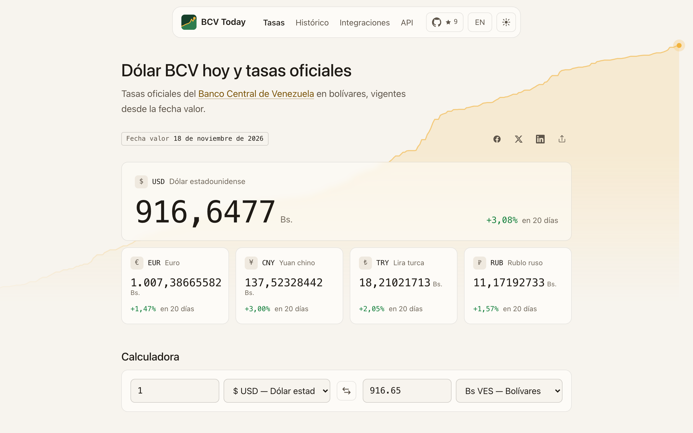
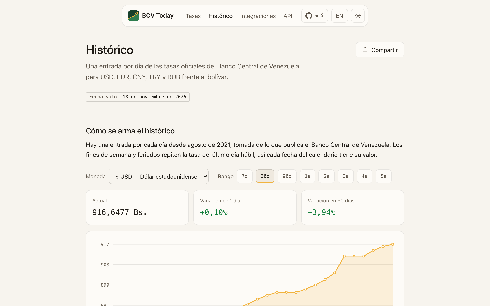
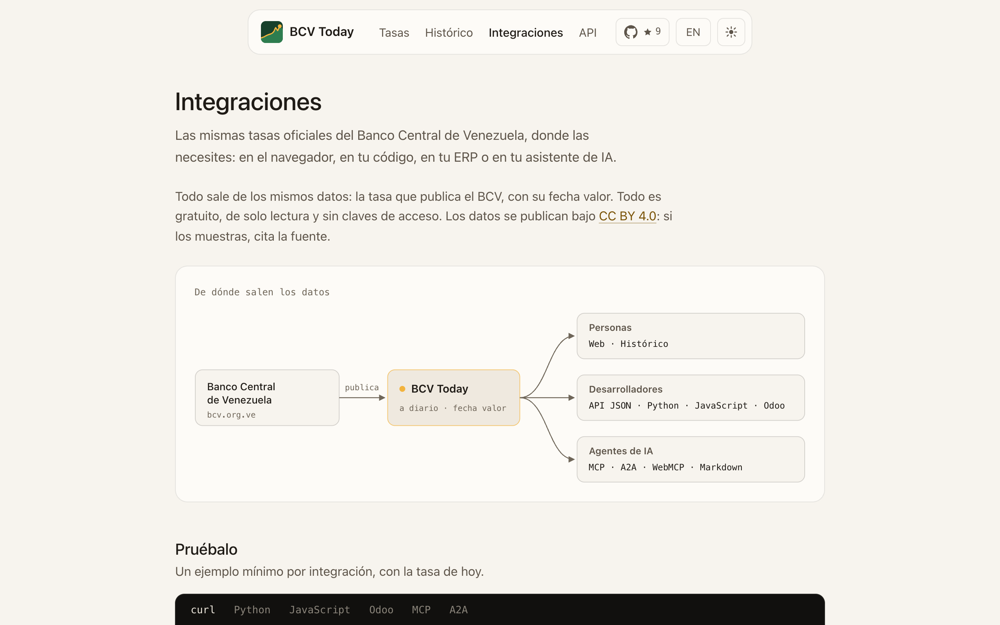
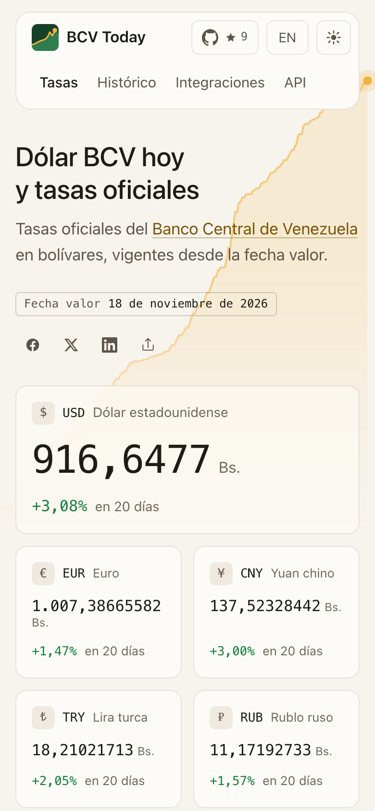

<p align="center">
  <a href="https://bcv.today"></a>
</p>

<h1 align="center">BCV Today</h1>

<p align="center">
  <a href="https://bcv.today">
    <picture>
      <source media="(prefers-color-scheme: dark)" srcset=".github/readme/home-dark.png">
      
    </picture>
  </a>
</p>

<p align="center">
  <a href="https://bcv.today"></a>
  <a href="https://bcv.today/api/"></a>
  <a href="https://bcv.today/api/v1/status.json"></a>
  <a href="https://bcv.today/api/v1/rate.json"></a>
  <a href="https://bcv.today/api/v1/rate.json"></a>
  <a href="https://github.com/grupoclip/bcv-api/actions/workflows/update-rate.yml"></a>
  <br>
  <a href="https://pypi.org/project/bcv/"></a>
  <a href="https://pypi.org/project/bcv/"></a>
  <a href="https://www.npmjs.com/package/bcv-today"></a>
  <a href="https://www.npmjs.com/package/bcv-today"></a>
  <a href="https://socket.dev/npm/package/bcv-today"></a>
  <a href="https://packagist.org/packages/grupoclip/bcv-today"></a>
  <a href="https://apps.odoo.com/apps/modules/l10n_ve_bcv_rate"></a>
  <a href="https://bcv.today/en/api/#mcp-server"></a>
  <br>
  <a href="LICENSE"></a>
  <a href="https://bcv.today/en/license/"></a>
</p>

> [bcv.today](https://bcv.today) - official Banco Central de Venezuela exchange rates, served as a static JSON API and dashboard.

BCV Today is an unofficial API and bilingual website for the exchange rates published by the [Banco Central de Venezuela](https://www.bcv.org.ve/). It tracks USD, EUR, CNY, TRY, and RUB against the Venezuelan bolivar, stores daily JSON snapshots, and publishes everything through GitHub Pages.

## Products

All of them use the same data, are free and need no API key. Overview page: [bcv.today/en/integrations](https://bcv.today/en/integrations/) ([español](https://bcv.today/integraciones/)).

| Product | For | Links |
| --- | --- | --- |
| Website | People | [bcv.today](https://bcv.today) ([English](https://bcv.today/en/)), [history](https://bcv.today/history/) |
| JSON API | Developers | [Docs](https://bcv.today/en/api/) ([español](https://bcv.today/api/)), [`/api/v1/`](https://bcv.today/api/v1/rate.json), [OpenAPI](https://bcv.today/openapi.json) |
| Python library `bcv` | Developers | [PyPI](https://pypi.org/project/bcv/) (`pip install bcv`, CLI `bcv`), [source](packages/python/) |
| npm package `bcv-today` | JavaScript/TypeScript developers | [npm](https://www.npmjs.com/package/bcv-today) (`npm install bcv-today`, CLI `bcv-today`), [source](packages/js/) |
| PHP package `grupoclip/bcv-today` | PHP and Laravel developers | [Packagist](https://packagist.org/packages/grupoclip/bcv-today) (`composer require grupoclip/bcv-today`), [source](packages/php/) |
| Web widget `<bcv-rate>` | Website owners | `<script type="module" src="https://bcv.today/widget/v1.js"></script>` + `<bcv-rate currency="USD"></bcv-rate>`, [source](packages/widget/) |
| Telegram | Everyone | Bot [@BCVTodayBot](https://t.me/BCVTodayBot) (`/dolar`, `/convertir 100 usd`, inline mode) and channel [@bcvtoday](https://t.me/bcvtoday) with the daily rate |
| Odoo module `l10n_ve_bcv_rate` | Odoo 16-20 users (Community and Enterprise, not Odoo Online) | [Odoo Apps](https://apps.odoo.com/apps/modules/l10n_ve_bcv_rate), [source](https://github.com/grupoclip/odoo-bcv-rate) |
| MCP server | AI assistants | `https://mcp.bcv.today/mcp` (Streamable HTTP, no auth), [server card](https://bcv.today/.well-known/mcp/server-card.json), [setup](https://bcv.today/en/api/#mcp-server) |
| A2A agent | AI agents | `https://mcp.bcv.today/a2a`, [agent card](https://bcv.today/.well-known/agent-card.json), [docs](https://bcv.today/en/api/#a2a-agent) |
| WebMCP tools | In-browser agents | Five read-only tools via `navigator.modelContext` ([`site/assets/js/webmcp.js`](site/assets/js/webmcp.js)) |
| Markdown and llms.txt | LLMs and agents | `Accept: text/markdown` or append `index.md` to any page, [llms.txt](https://bcv.today/llms.txt), [llms-full.txt](https://bcv.today/llms-full.txt), [AI catalog](https://bcv.today/.well-known/ai-catalog.json) |

Code: Apache 2.0; data: CC BY 4.0 ([license](https://bcv.today/en/license/)).

[Contributing](CONTRIBUTING.md) · [Accessibility](ACCESSIBILITY.md) · [Security](SECURITY.md) · [Code of conduct](CODE_OF_CONDUCT.md)

## Website

The public site is available at:

> https://bcv.today

<table>
  <tr>
    <td width="33%" valign="top">
      <a href="https://bcv.today/history/">
        <picture>
          <source media="(prefers-color-scheme: dark)" srcset=".github/readme/history-dark.png">
          
        </picture>
      </a>
      <p align="center"><b>History</b> · chart and table since 2021</p>
    </td>
    <td width="33%" valign="top">
      <a href="https://bcv.today/integraciones/">
        <picture>
          <source media="(prefers-color-scheme: dark)" srcset=".github/readme/integrations-dark.png">
          
        </picture>
      </a>
      <p align="center"><b>Integrations</b> · API, libraries, Odoo, MCP</p>
    </td>
    <td width="33%" valign="top" align="center">
      <a href="https://bcv.today">
        <picture>
          <source media="(prefers-color-scheme: dark)" srcset=".github/readme/mobile-dark.png">
          
        </picture>
      </a>
      <p align="center"><b>Mobile</b> · light and dark theme</p>
    </td>
  </tr>
</table>

Pages:

- `/` and `/en/` - latest rates dashboard with rate cards, daily variation, and a currency calculator.
- `/history/` and `/en/history/` - historical chart, current value, daily change, period change, and table view.
- `/api/` and `/en/api/` - API documentation with endpoints, response schema, and examples.

Features:

- **Static JSON API** - files are committed under `api/` and served directly by GitHub Pages.
- **Calendar history** - weekends and holidays are filled with the latest officially effective rate.
- **Bilingual UI** - Spanish and English strings live in `site/_data/i18n.yml`.
- **Light/dark mode** - follows `prefers-color-scheme` and stores manual selection in `localStorage`.
- **No server runtime** - the site is built with Jekyll; dashboard data is loaded client-side from JSON files.

## API Endpoints

Base URL:

```text
https://bcv.today
```

API v1 root:

```text
https://bcv.today/api/v1
```

| Resource | Path | Description |
| --- | --- | --- |
| Latest rate | `/api/v1/rate.json` | Today's current rate entry. |
| History index | `/api/v1/history.json` | Up to the latest 1830 daily entries. |
| History by date | `/api/v1/history/YYYY-MM-DD.json` | One calendar-day snapshot. |
| API status | `/api/v1/status.json` | Freshness, API version and currency availability. |

Example:

```bash
curl -s https://bcv.today/api/v1/rate.json
```

Current response shape:

```json
{
  "USD": 500.4606,
  "EUR": 589.27233807,
  "CNY": 73.59606476,
  "TRY": 11.03277068,
  "RUB": 6.71398712,
  "updated_at": "2026-05-11T13:28:27.091112+00:00",
  "effective_date": "2026-05-11",
  "date": "2026-05-11"
}
```

Fields:

- `USD`, `EUR`, `CNY`, `TRY`, `RUB` - bolivares per 1 unit of the foreign currency. The latest-rate endpoint includes all five currencies; older historical backfills may omit currencies that were unavailable in the source data.
- `updated_at` - UTC timestamp when the scraper captured the rate.
- `date` - calendar date represented by the file.
- `effective_date` - official BCV validity date. On weekends and holidays this can point to the previous business day whose rate is still in effect.
- `source` - optional field present on some historical backfill entries.

## How The Data Works

`scraper/main.py` fetches `https://www.bcv.org.ve/`, parses the published currency blocks, and reads BCV's `Fecha Valor` when available.

On each run it:

1. Writes the canonical snapshot to `site/api/v1/history/<effective-date>.json`.
2. Rebuilds calendar history from the earliest stored snapshot through today.
3. Fills weekends, holidays, and missing dates with the latest rate whose `effective_date` is less than or equal to that day.
4. Writes `site/api/v1/rate.json` as today's current rate, filling missing currencies from the latest available source when older backfills only include USD/EUR.
5. Rebuilds `site/api/v1/history.json` with the latest 1830 entries.

BCV usually publishes on business days around 16:30 Caracas time, effective for the following business day. The workflow runs often and commits only when `site/api/` changes.

## Automation

Two GitHub Actions workflows keep the project updated and deployed:

- `.github/workflows/update-rate.yml`
  - Runs every 30 minutes.
  - Can be run manually with `workflow_dispatch`.
  - Also runs on pushes that change `scraper/` or the workflow itself.
  - Installs Python dependencies, runs `python scraper/main.py`, commits changed `site/api/` files, and triggers the Pages deploy workflow.

- `.github/workflows/pages.yml`
  - Builds the Jekyll site with Ruby 3.3.
  - Deploys to GitHub Pages.
  - Runs on pushes to `main` and manual dispatch.

## Local Development

Install Python dependencies and update the local JSON files:

```bash
pip install -r scraper/requirements.txt
python scraper/main.py
```

Preview the website locally:

```bash
cd site
bundle install
bundle exec jekyll serve --baseurl ""
```

Then open:

```text
http://127.0.0.1:4000
```

## Project Structure

```text
.
├── site/                    # Jekyll website, served at https://bcv.today
│   ├── _config.yml, Gemfile, CNAME
│   ├── _layouts/ _includes/ # shared templates
│   ├── _data/               # i18n strings, FAQ, integrations, latest rate (written by the scraper)
│   ├── assets/              # CSS, JS (dashboard, history, WebMCP, liquidGL), images
│   ├── api/v1/              # the public JSON API, generated by the scraper
│   ├── en/                  # English pages
│   ├── pages/               # currency pages and short aliases (each sets its own permalink)
│   ├── .well-known/         # agent discovery: MCP/A2A cards, API catalog, skills, Web Bot Auth keys
│   └── index.html, history.html, llms.txt, openapi.json, ...
├── scraper/                 # main.py: BCV scraper and JSON writer (runs every 30 minutes in CI)
├── packages/
│   ├── python/              # PyPI package `bcv`
│   ├── js/                  # npm package `bcv-today`
│   └── mcp/                 # Cloudflare Worker: MCP server + A2A agent at mcp.bcv.today
├── scripts/                 # build helpers: HTML -> Markdown, Web Bot Auth directory signing
└── .github/workflows/       # data updates, Pages deploy, package CI and releases
```

URLs do not follow the folder layout: `site/api/v1/rate.json` is served at `/api/v1/rate.json`, and the
files in `site/pages/` declare their URLs with `permalink`.

## Repository Setup

For a fork or new deployment:

1. Enable GitHub Pages with **Settings -> Pages -> Build and deployment -> GitHub Actions**.
2. Allow workflow writes with **Settings -> Actions -> General -> Workflow permissions -> Read and write permissions**.
3. Update `site/_config.yml` if the domain, base URL, or repository name changes.
4. Update `site/CNAME` if using a custom domain.

## Disclaimer

This project is not affiliated with the Banco Central de Venezuela. Rates are scraped from the public BCV website and provided as-is, without uptime, accuracy, or financial-use guarantees. Verify against the official BCV source before relying on the data.

## License

- **Code** (scraper, site, scripts): [Apache License 2.0](LICENSE).
- **Data and API content** (the JSON files, the history, the site texts): [Creative Commons Attribution 4.0 International (CC BY 4.0)](LICENSE-DATA.md). Free to use, including commercially; the only condition is attribution, for example: `Source: Banco Central de Venezuela, via BCV Today (https://bcv.today)`.

The exchange rates themselves are official public facts published by Banco Central de Venezuela; CC BY 4.0 covers BCV Today's compilation, format, history and texts. The "BCV Today" name and logo are not covered by either license. Data is provided as is; for legal or accounting use, verify against [bcv.org.ve](https://www.bcv.org.ve/).

Details and attribution examples: [bcv.today/licencia/](https://bcv.today/licencia/) (Spanish) and [bcv.today/en/license/](https://bcv.today/en/license/) (English).
